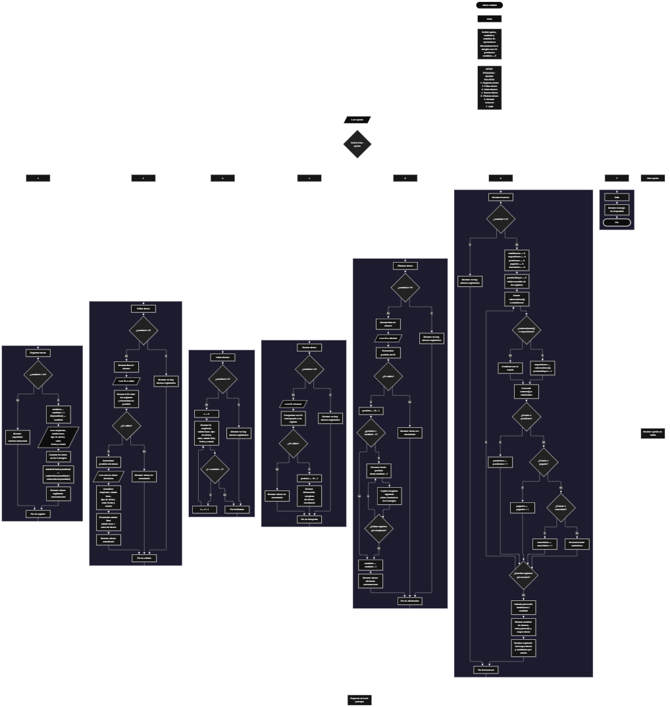

Este proyecto, llamado <b>abono salarial</b>, fue desarrollado en <b>visual basic .net</b> como un ejercicio práctico para fortalecer la lógica de programación mediante la creación de un sistema de gestión de abonos salariales desde la consola. El programa cuenta con un menú principal de siete opciones que permite <b>registrar, editar, listar, buscar y eliminar abonos salariales, además de consultar un resumen general</b> de la información registrada. Cada abono almacena datos como el identificador, el nombre del empleado, el salario base, el tipo de abono, el valor del abono, el salario final, la fecha y el estado, utilizando ocho arreglos con una capacidad máxima de <b>10 registros durante la ejecución</b>. Durante su desarrollo se aplicaron conceptos fundamentales de programación, como variables, arreglos, estructuras condicionales, ciclos repetitivos y estructuras de selección, además de operaciones para calcular salarios, buscar, modificar, eliminar y organizar registros. Este proyecto permite poner en práctica los conocimientos adquiridos en Visual Basic .NET y sirve como base para desarrollar sistemas de gestión más avanzados.

<h2 align="center">⚙️ Funcionamiento del menú principal</h2>

### ➕ Registrar abono

La opción <b>1) registrar abono</b> permite agregar un nuevo abono salarial al sistema. Antes de realizar el registro, el programa comprueba que la cantidad de abonos almacenados sea menor a <b>10</b>. Si existe espacio disponible, genera un identificador para el nuevo registro y solicita los datos correspondientes al <b>empleado, salario base, tipo de abono, valor del abono, fecha y estado</b>. La información se almacena en la posición correspondiente de los ocho arreglos: <b>ids, empleados, salariosBase, tiposAbono, valoresAbono, salariosFinales, fechas y estados</b>. Después, calcula el salario final mediante la suma del salario base y el valor del abono. Finalmente, aumenta la cantidad de registros y muestra un mensaje de confirmación. Si se alcanza la capacidad máxima, impide registrar otro abono.

### ✏️ Editar abono

La opción <b>2) editar abono</b> permite modificar la información de un abono salarial registrado. Primero, el programa comprueba si existen registros almacenados mediante la variable <b>cantidad</b>. Si no hay abonos registrados, muestra un mensaje indicando que no existen registros disponibles. En caso contrario, presenta la información de los abonos y solicita el identificador del registro que se desea editar. Después, comprueba que el identificador corresponda a un abono registrado y determina la posición que debe modificarse. Si la selección es válida, solicita nuevamente los datos del empleado, salario base, tipo de abono, valor del abono, fecha y estado. Los nuevos valores se almacenan en los arreglos correspondientes y se vuelve a calcular el <b>salario final</b> mediante la suma del salario base y el valor del abono. Finalmente, muestra un mensaje indicando que el abono fue actualizado. Si el identificador no corresponde a un registro existente, informa que no se encontró el abono seleccionado.

### 📋 Listar abonos

La opción <b>3) listar abonos</b> permite visualizar todos los abonos salariales registrados actualmente en el sistema. Antes de mostrar la información, el programa comprueba si la variable <b>cantidad</b> es igual a cero. Si no existen registros, presenta un mensaje indicando que no hay abonos registrados. Si hay información disponible, utiliza un ciclo <b>For</b> para recorrer los arreglos desde la primera posición hasta la cantidad total de registros. Durante el recorrido, muestra los datos correspondientes a cada abono, incluyendo su identificador, empleado, salario base, tipo de abono, valor del abono, salario final, fecha y estado. Esta función facilita consultar los registros almacenados sin necesidad de buscar cada abono individualmente.

### 🔎 Buscar abono

La opción <b>4) buscar abono</b> permite localizar un abono salarial mediante su identificador. Primero, el programa comprueba si existen registros almacenados. Si no hay abonos, muestra un mensaje indicando que no existen registros disponibles. En caso contrario, solicita el identificador del abono que se desea buscar y comprueba que corresponda a un registro existente. Cuando el identificador es válido, determina la posición correspondiente dentro de los arreglos y muestra la información completa del abono, incluyendo el empleado, salario base, tipo de abono, valor del abono, salario final, fecha y estado. Si el identificador no corresponde a un abono registrado, muestra un mensaje indicando que no se encontró el registro solicitado.

### 🗑️ Eliminar abono

La opción <b>5) eliminar abono</b> permite eliminar un abono salarial mediante su identificador. Antes de comenzar, el programa comprueba que existan registros almacenados. Si no hay abonos, muestra un mensaje indicando que no existen registros disponibles. Si hay información, presenta los abonos registrados y solicita el identificador del registro que se desea eliminar. Después, verifica que el identificador corresponda a un abono existente y determina su posición dentro de los arreglos. Para mantener los registros organizados, utiliza un ciclo <b>For</b> que desplaza una posición hacia atrás los datos de los abonos posteriores en los ocho arreglos: <b>ids, empleados, salariosBase, tiposAbono, valoresAbono, salariosFinales, fechas y estados</b>. Posteriormente, disminuye la variable <b>cantidad</b> en uno y muestra un mensaje de confirmación. De esta manera, los datos de cada abono permanecen relacionados durante el proceso de eliminación.

### 📊 Mostrar resumen

La opción <b>6) mostrar resumen</b> permite consultar estadísticas generales de los abonos salariales registrados. Primero, el programa comprueba si existen registros disponibles. Cuando hay abonos, inicializa las variables utilizadas para realizar los cálculos, como <b>totalAbonos, mayorAbono, posicionMayor, pendientes, pagados y cancelados</b>. Después, utiliza un ciclo <b>For</b> para recorrer los registros almacenados y acumular los valores de los abonos, identificar el abono de mayor valor y contar los registros según su estado. Para identificar el abono más alto, compara cada valor con la variable <b>mayorAbono</b> y actualiza la posición cuando encuentra un valor superior. También utiliza el método <b>ToLower()</b> para comparar los estados sin distinguir entre mayúsculas y minúsculas. Finalmente, calcula el promedio de los abonos y muestra la cantidad de registros, el total acumulado, el promedio, el empleado con el mayor abono, su valor y las cantidades de abonos pendientes, pagados y cancelados. Si no existen registros, informa que no hay información disponible para generar el resumen.

### 🚪 Salir del menú principal

La opción <b>7) salir</b> está destinada a finalizar la ejecución del programa y muestra un mensaje de despedida. El menú principal se encuentra dentro de una estructura repetitiva <b>Do While</b>, que mantiene el programa en funcionamiento mientras se realizan las diferentes operaciones disponibles. Cuando el usuario selecciona la opción <b>7</b>, se cumple la condición de salida del ciclo y finaliza la ejecución del programa.

<h2 align="center">🧠 Temas aplicados en el proyecto</h2>

### 📦 Variables

En este proyecto se utilizan variables para almacenar la opción seleccionada en el menú, controlar la cantidad de abonos registrados, realizar los cálculos salariales, identificar los registros que se desean modificar o eliminar y generar las estadísticas del resumen. Cada variable cumple una función específica dentro de las operaciones del sistema, permitiendo administrar la información y realizar los procesos necesarios.

🔢 **Opcion:** Almacena la opción seleccionada por el usuario en el menú principal.

📊 **Cantidad:** Controla la cantidad actual de abonos salariales registrados.

🔎 **Identificadores:** Permiten identificar los abonos almacenados y localizar los registros que se desean consultar, modificar o eliminar.

💰 **TotalAbonos:** Acumula el valor de todos los abonos registrados.

📈 **MayorAbono:** Almacena el valor del abono salarial más alto encontrado durante el recorrido.

📍 **PosicionMayor:** Guarda la posición del registro que contiene el abono de mayor valor.

⏳ **Pendientes:** Cuenta la cantidad de abonos que tienen el estado pendiente.

✅ **Pagados:** Cuenta la cantidad de abonos que tienen el estado pagado.

❌ **Cancelados:** Cuenta la cantidad de abonos que tienen el estado cancelado.

### 🗃️ Arreglos

En este proyecto se utilizan ocho arreglos relacionados con la información de cada abono salarial. Cada arreglo tiene una capacidad de <b>10 posiciones</b> y utiliza el mismo índice para representar los datos correspondientes a un mismo registro. Por ejemplo, la información de un abono almacenado en una posición se encuentra distribuida entre los arreglos <b>ids, empleados, salariosBase, tiposAbono, valoresAbono, salariosFinales, fechas y estados</b>. Esta organización permite recorrer, buscar, modificar, mostrar y eliminar los registros de manera ordenada.

🆔 **Ids[10]:** Almacena los identificadores de los abonos salariales.

👤 **Empleados[10]:** Almacena los nombres de los empleados.

💵 **SalariosBase[10]:** Guarda los salarios base de los empleados.

📌 **TiposAbono[10]:** Almacena los tipos de abono salarial.

💰 **ValoresAbono[10]:** Guarda los valores correspondientes a cada abono.

🧮 **SalariosFinales[10]:** Almacena el resultado de sumar el salario base y el valor del abono.

📅 **Fechas[10]:** Almacena las fechas correspondientes a los abonos.

📋 **Estados[10]:** Guarda el estado de cada abono salarial.

### 🔀 Estructuras condicionales

En este proyecto se utilizan las estructuras <b>If, ElseIf y Else</b> para comprobar diferentes condiciones durante la ejecución del programa. Estas estructuras permiten verificar si existen abonos registrados antes de realizar determinadas operaciones, comprobar si hay espacio disponible para agregar nuevos registros, validar los identificadores introducidos por el usuario y determinar cuál es el abono de mayor valor. También se utilizan para clasificar los abonos según su estado, identificando los registros pendientes, pagados y cancelados. Estas condiciones permiten que el programa responda de manera diferente según la información almacenada y los resultados de cada operación.

### 🔄 Estructuras repetitivas

En este proyecto se utilizan los ciclos <b>Do While</b> y <b>For</b>. El ciclo <b>Do While</b> mantiene activo el menú principal y permite que el usuario realice diferentes operaciones hasta seleccionar la opción de salida. Por otro lado, los ciclos <b>For</b> permiten recorrer los arreglos para mostrar los abonos registrados, acceder a los datos de un registro, realizar búsquedas y calcular las estadísticas del resumen. Durante la eliminación, también se utiliza un ciclo <b>For</b> para desplazar los datos de los registros posteriores una posición hacia atrás en los ocho arreglos.

### 🎯 Estructura de selección

El programa utiliza la estructura <b>Select Case</b> para evaluar el valor almacenado en la variable <b>opcion</b> y ejecutar el bloque de instrucciones correspondiente. Cada caso representa una operación específica del sistema: <b>registrar, editar, listar, buscar, eliminar, mostrar resumen o salir</b>. Esta estructura permite organizar las diferentes funcionalidades del menú principal y ejecutar únicamente las instrucciones correspondientes a la opción seleccionada por el usuario.

### 🔢 Dimensionamiento de arreglos

El programa utiliza arreglos declarados con un índice máximo de <b>9</b>, lo que permite disponer de <b>10 posiciones</b> para almacenar la información de los abonos salariales. Los ocho arreglos comparten la misma capacidad y se relacionan mediante sus posiciones para mantener organizados los datos de cada empleado. La cantidad de registros ocupados se controla mediante la variable <b>cantidad</b>, que permite administrar los abonos almacenados durante la ejecución del programa.

### 🔄 Reorganización de registros

Cuando se selecciona un abono para eliminarlo, el programa utiliza un ciclo <b>For</b> para desplazar los registros posteriores una posición hacia atrás. En cada repetición, los datos de la posición siguiente se copian sobre la posición actual en los ocho arreglos: <b>ids, empleados, salariosBase, tiposAbono, valoresAbono, salariosFinales, fechas y estados</b>. Después, la variable <b>cantidad</b> disminuye en uno para actualizar el número de registros almacenados. De esta manera, los datos de cada abono permanecen organizados y relacionados después de realizar la eliminación.

<h2 align="center">¿Cómo se implementaron las operaciones crud en el proyecto?</h2>

Las operaciones <b>crud</b> se implementaron mediante las opciones del menú principal, permitiendo administrar los abonos salariales registrados. La operación <b>crear</b> corresponde a <b>registrar abono</b>, donde se introducen los datos de un nuevo empleado y su abono; <b>leer</b> se realiza mediante las opciones <b>buscar abono y listar abonos</b>, que permiten consultar la información almacenada; <b>actualizar</b> corresponde a <b>editar abono</b>, donde se modifican los datos de un registro existente; y <b>eliminar</b> se realiza mediante la opción <b>eliminar abono</b>, que retira un registro y reorganiza los datos de los ocho arreglos. Estas operaciones utilizan variables, arreglos, estructuras condicionales y ciclos para gestionar la información almacenada temporalmente durante la ejecución del programa.

<h2 align="center">Diagrama de flujo del proyecto</h2>

<h2 align="center">🛡️ Validaciones del programa</h2>

### 📭 No existen abonos registrados

Esta validación se utiliza en las operaciones que necesitan consultar información almacenada. El programa comprueba si la variable <b>cantidad</b> es igual a <b>0</b> y, si no existen abonos registrados, muestra un mensaje indicando que no hay registros disponibles. Esta comprobación evita continuar con las operaciones que necesitan información almacenada cuando el sistema se encuentra vacío.

### ⚠️ Capacidad máxima alcanzada

Esta validación se utiliza durante el registro de nuevos abonos para controlar la capacidad máxima de los arreglos. El programa comprueba que la cantidad de registros sea menor a <b>10</b> antes de permitir agregar otro abono. Si existe espacio disponible, continúa con el registro de los datos. En caso contrario, impide agregar nuevos registros porque se ha alcanzado la capacidad máxima establecida.

### 🔎 Identificador de abono

Esta validación se utiliza durante las operaciones de edición, búsqueda y eliminación. El programa comprueba que el identificador introducido corresponda a un abono registrado dentro de la cantidad actual de registros. Si el identificador es válido, determina la posición correspondiente para acceder a la información almacenada. Si no corresponde a un registro existente, muestra un mensaje indicando que no se encontró el abono solicitado.

### 📊 Clasificación de los estados

Durante la generación del resumen, el programa utiliza condiciones para identificar los estados de cada abono salarial. Mediante el método <b>ToLower()</b>, convierte el texto del estado a minúsculas antes de compararlo, permitiendo contar los registros correspondientes a <b>pendiente, pagado y cancelado</b> sin distinguir entre letras mayúsculas y minúsculas. De esta manera, los contadores se actualizan según el estado almacenado en cada registro.

### 💰 Cálculo del salario final

Al registrar o editar un abono, el programa calcula el salario final mediante la suma del <b>salario base</b> y el <b>valor del abono</b>. El resultado se almacena en el arreglo <b>salariosFinales</b>, permitiendo consultar el valor calculado junto con los demás datos del empleado.

<h2 align="center">🎯 Objetivo del proyecto</h2>

El objetivo principal de este proyecto es fortalecer la <b>lógica de programación</b> mediante el desarrollo de un sistema de gestión de abonos salariales en <b>visual basic .net</b>. A través de su construcción se busca aplicar los conocimientos adquiridos sobre variables, arreglos, estructuras condicionales, ciclos repetitivos y estructuras de selección, integrándolos para resolver un problema de manera organizada. Además, el proyecto permite comprender cómo registrar, consultar, modificar y eliminar información, realizar cálculos salariales y generar estadísticas a partir de los datos almacenados en una aplicación de consola.

